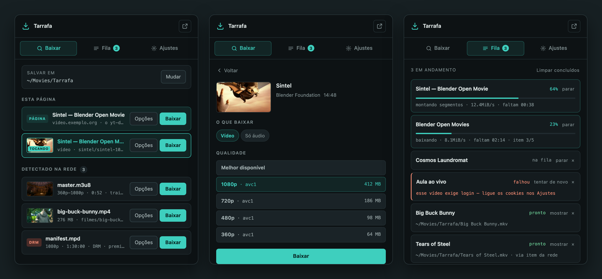
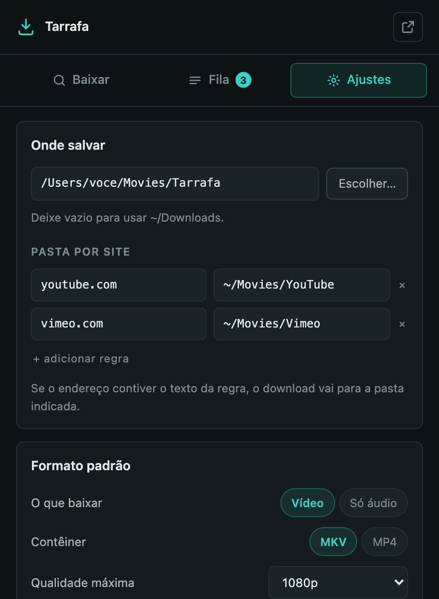

# Tarrafa

[](https://github.com/arnaldobatista/tarrafa/actions/workflows/verificar.yml)
[](LICENSE)


Extensão para Chrome que encontra vídeo e áudio em qualquer site e baixa para **a pasta que você escolher**, usando o `yt-dlp` e o `ffmpeg` da sua própria máquina.

*In English: a Chrome extension for macOS that finds video and audio on any website and downloads it to any folder, using your own `yt-dlp` and `ffmpeg` through a small native messaging host. The docs are in Portuguese; issues and pull requests in English are welcome.*

> Tarrafa é a rede de arremesso do pescador: você lança sobre a correnteza e recolhe o que estava passando. A extensão faz o mesmo com a página e com o tráfego de rede.



Extensões de navegador não conseguem gravar fora da pasta de downloads nem executar o `ffmpeg`. A Tarrafa contorna isso com um host nativo pequeno, em Node, que o navegador chama por *native messaging*: a extensão encontra a mídia e decide o que baixar; o host executa o `yt-dlp` na sua máquina.

## Recursos

- **Detecção em qualquer site** — fareja HLS (`.m3u8`), DASH (`.mpd`) e arquivos diretos na rede, inclusive dentro de iframes, e varre a página atrás de players embutidos, elementos `<video>` e URLs de mídia escritas no código.
- **Leitura de manifesto** — cada playlist é aberta e interpretada: resoluções disponíveis, duração, se é ao vivo, se tem DRM. Playlists filhas que já estão dentro de uma mestre não se repetem na lista, e o que parecia manifesto mas não era é descartado.
- **Miniatura de cada item**, gerada com um quadro do próprio vídeo, para você saber o que está baixando.
- **O vídeo que está tocando** fica marcado e sobe para o topo.
- **Qualquer pasta de destino**, com regras por site (`youtube.com` → `~/Movies/YouTube`) ou a opção de perguntar a cada download.
- **Escolha de qualidade** vendo o tamanho de cada resolução antes de baixar.
- **Nome decente e editável** — quando a URL da mídia não tem nome útil (`master.m3u8`, `video.mp4`), o arquivo leva o título da página. O campo **Salvar como** deixa trocar antes de baixar, e um nome repetido vira `(2)`, `(3)` em vez de ser pulado.
- **Áudio sem perda** — extrai a faixa no codec original (AAC/Opus), sem reencodar; MP3 continua disponível.
- **Cortar um trecho** (`1:30` até `4:00`) por cópia de stream, sem reencodar.
- **Legendas** por idioma, incluindo as automáticas, embutidas no arquivo ou como `.srt`.
- **SponsorBlock** para remover patrocínio, autopromoção, abertura e mais.
- **Capa, metadados e capítulos** embutidos; opção de dividir um vídeo longo em um arquivo por capítulo.
- **Playlists** inteiras ou por intervalo (`1-10`), numeradas numa pasta própria.
- **Seus cookies do navegador**, para conteúdo que exige login.
- **Fila** com downloads simultâneos, retomada e histórico.
- **Menu do botão direito** e **notificação** ao terminar.

Quando o `yt-dlp` não conhece um site, a Tarrafa tenta automaticamente pelo melhor item detectado na rede.

## Como funciona

```
 navegador                                    sua máquina
┌────────────────────────────────────┐       ┌──────────────────────────┐
│  página ─► varredura (iframes,     │       │  host.js  (Node)         │
│            <video>, código)        │native │   ├─ yt-dlp   download   │
│  rede   ─► webRequest (HLS, DASH,  │◄─────►│   ├─ ffmpeg   junta/corta│
│            arquivos, cabeçalhos)   │ msg   │   └─ deno     YouTube    │
│                                    │       │                          │
│  painel: Baixar · Fila · Ajustes   │       │  grava onde você mandar  │
└────────────────────────────────────┘       └──────────────────────────┘
```

A extensão decide **o que** baixar; o host decide **como**. Toda a tradução de opções para argumentos do `yt-dlp` fica em um só lugar, `montarArgs()` em `host/host.js`.

## Requisitos

- macOS
- Um navegador Chromium: Chrome, Chromium, Brave, Edge, Vivaldi ou Arc
- Pelo Homebrew:

```bash
brew install node yt-dlp ffmpeg deno
```

O `deno` é obrigatório para o YouTube: o site assina as URLs de mídia com um desafio em JavaScript, e sem um runtime para resolvê-lo o `yt-dlp` recebe `403`.

## Instalação

1. Clone este repositório e rode o instalador dentro dele:

   ```bash
   git clone https://github.com/arnaldobatista/tarrafa.git
   cd tarrafa
   ./install.sh
   ```

   O script encontra `node`, `yt-dlp`, `ffmpeg` e `deno`, copia o host para `~/Library/Application Support/Tarrafa/` e o registra em todos os navegadores compatíveis instalados.

2. Abra `chrome://extensions`, ligue o **Modo do desenvolvedor**, clique em **Carregar sem compactação** e escolha a pasta `extension/`.

O ID da extensão é sempre `dmofiaiidmkialeopkpcknbaapkohfmn`, fixado pela chave pública no `manifest.json` — é isso que permite ao `install.sh` autorizá-la antes mesmo de você carregá-la.

> **Por que o host é copiado para fora do repositório:** o macOS protege `~/Documents`, `~/Desktop` e `~/Downloads`, e o navegador não consegue executar um host nativo guardado ali. A falha aparece só como `Native host has exited`, sem nenhuma linha no log. Por isso, **se você editar `host/host.js`, rode `./install.sh` de novo.**

## Atualizar

```bash
git pull
./install.sh
```

Depois, recarregue a extensão (↻ em `chrome://extensions`). O `install.sh` pode rodar quantas vezes você quiser: ele só recopia o host e reescreve o registro.

> **Por que recarregar:** as telas leem os arquivos novos na hora, mas o Chrome continua rodando o `background.js` anterior até a extensão ser recarregada. A Tarrafa percebe a diferença e mostra o botão **Recarregar extensão**.

## Uso

Clique no ícone da extensão ou use **⌘⇧U** (**Alt+Shift+D** fora do Mac).

- **Baixar** — o que dá para baixar na aba atual: a própria página, os players e vídeos encontrados nela e o que passou pela rede. **Baixar** usa os seus padrões; **Opções** abre os detalhes.
- **Opções** — consulta o site e mostra título, canal, duração, capítulos e as qualidades disponíveis com tamanho. Ali você escolhe tipo, qualidade, contêiner, legendas, SponsorBlock, trecho, playlist, nome do arquivo e destino.
- **Fila** — downloads em andamento primeiro, com progresso, velocidade e tempo restante; depois o histórico. Dá para parar, tentar de novo e mostrar o arquivo no Finder.
- **Ajustes** — os padrões de tudo e o diagnóstico da instalação.

Pelo botão direito em uma página, vídeo ou link: **Baixar com a Tarrafa** ou **Baixar só o áudio**.

## Ajustes



| Ajuste | Padrão |
|---|---|
| Pasta de destino | `~/Downloads` |
| Pasta por site | nenhuma regra |
| Perguntar onde salvar a cada download | desligado |
| O que baixar | vídeo |
| Contêiner | MKV |
| Qualidade máxima | melhor disponível |
| Formato do áudio | original |
| Legendas | desligado (idiomas `pt, en`, embutidas) |
| SponsorBlock | desligado (patrocínio e autopromoção) |
| Capa, metadados e capítulos | ligados |
| Usar cookies do navegador | ligado |
| Gravar lives desde o início | desligado |
| Notificações | ligadas |
| Menu do botão direito | ligado |
| Downloads simultâneos | 2 |

## Solução de problemas

O log traz a linha de comando exata de cada execução do `yt-dlp`:

```bash
tail -30 ~/Library/Logs/tarrafa.log
```

- **`403` no YouTube** — veja se o log mostra `No supported JavaScript runtime` logo antes. Se sim, falta o `deno`.
- **`429`** — o site está limitando requisições. Espere alguns minutos.
- **`Native host has exited` sem nenhuma linha nova no log** — o host nem chegou a rodar. Rode `./install.sh`.
- **`Specified native messaging host not found` logo depois de atualizar** — é o `background.js` anterior ainda rodando. Recarregue a extensão (botão no aviso ou ↻ em `chrome://extensions`). Se continuar, rode `./install.sh`.
- **Um site que funcionava parou** — quase sempre o `yt-dlp` envelheceu. A tela de Ajustes avisa quando ele está velho.

  ```bash
  brew upgrade yt-dlp
  ```

## Privacidade e segurança

- Não há telemetria. As únicas requisições são para os próprios sites de onde você baixa — e para a base do SponsorBlock, se você ligar esse recurso.
- Com **Usar cookies do navegador** ligado, a extensão lê os cookies do domínio do site (e do `google.com`, no caso do YouTube), grava um arquivo temporário com permissão `600`, entrega ao `yt-dlp` e o apaga assim que o download termina.
- O log registra cada comando do `yt-dlp`, mas os valores de `Cookie` e `Authorization` aparecem como `[oculto]` — dá para colar o log numa issue sem expor sua sessão.
- O host nativo só aceita conexões da extensão cujo ID está no seu registro (`allowed_origins`).
- A chave privada que gera o ID (`host/key.pem`) não faz parte do repositório.

Encontrou uma falha de segurança? Veja [SECURITY.md](SECURITY.md) — relate em particular, não numa issue.

## Desinstalar

```bash
./uninstall.sh
```

Remove o registro do host em todos os navegadores e a pasta `~/Library/Application Support/Tarrafa/`. Depois, remova a extensão em `chrome://extensions`.

## Estrutura

```
extension/
  manifest.json      Manifest V3, com chave fixa (ID determinístico)
  background.js      detecção, leitura de manifestos, fila, cookies, menu
  app.html           as telas do painel
  app.css            tema escuro
  app.js             interface
  icons/
host/
  host.js            native messaging + yt-dlp/ffmpeg
  extid.txt          ID da extensão, lido pelo install.sh
install.sh           instala e registra o host
uninstall.sh         remove tudo que o install.sh criou
navegadores.sh       onde cada navegador procura hosts nativos
docs/                capturas de tela (usadas aqui e avulsas)
.github/             modelos de issue e pull request, verificação automática
CHANGELOG.md         o que mudou em cada versão
CONTRIBUTING.md      como preparar o ambiente e contribuir
SECURITY.md          como relatar uma vulnerabilidade
LICENSE              licença MIT
```

## Limitações

- **Só macOS.** Os caminhos de instalação, o seletor de pastas e o "mostrar no Finder" são do macOS.
- **DRM não é contornado.** Conteúdo protegido por Widevine, PlayReady ou FairPlay é identificado e sinalizado na lista; o `yt-dlp` não baixa esse conteúdo.
- **Players que montam o vídeo em memória** (URL `blob:`) não podem ser casados pela URL; nesses casos o item que está tocando é inferido pelo momento em que a mídia passou na rede e aparece como **Provável**.
- Se um site guardar a URL da mídia só na memória do JavaScript, sem escrevê-la na página nem pedi-la pela rede, nenhuma das estratégias de detecção a alcança.

## Uso responsável

A Tarrafa é uma ferramenta para uso pessoal. Baixe apenas conteúdo que você tem direito de baixar e respeite os termos de uso de cada site e os direitos autorais de quem produziu o conteúdo.

## Contribuir

Correções, sites novos e ideias são bem-vindos. O [CONTRIBUTING.md](CONTRIBUTING.md) explica como montar o ambiente, o ciclo de edição e o que conferir antes de abrir um pull request. As mudanças de cada versão ficam no [CHANGELOG.md](CHANGELOG.md).

## Licença

[MIT](LICENSE). Você pode usar, copiar, modificar, distribuir e até vender, contanto que mantenha o aviso de copyright e o texto da licença em toda cópia ou trecho substancial do código — é assim que a referência ao projeto original fica preservada.

As imagens de demonstração usam quadros de *Sintel* e *Big Buck Bunny*, © Blender Foundation, sob licença [CC BY 3.0](https://creativecommons.org/licenses/by/3.0/).
